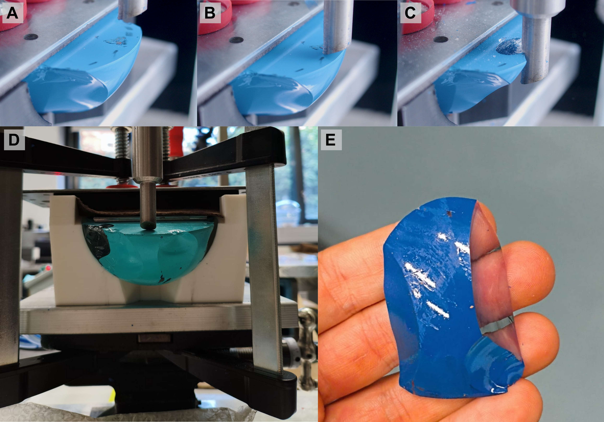
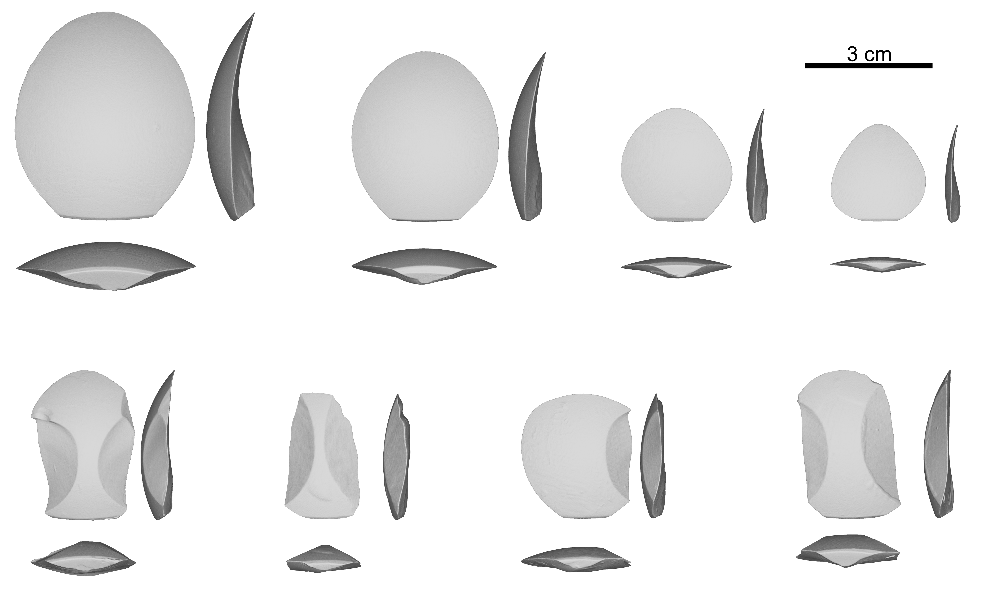
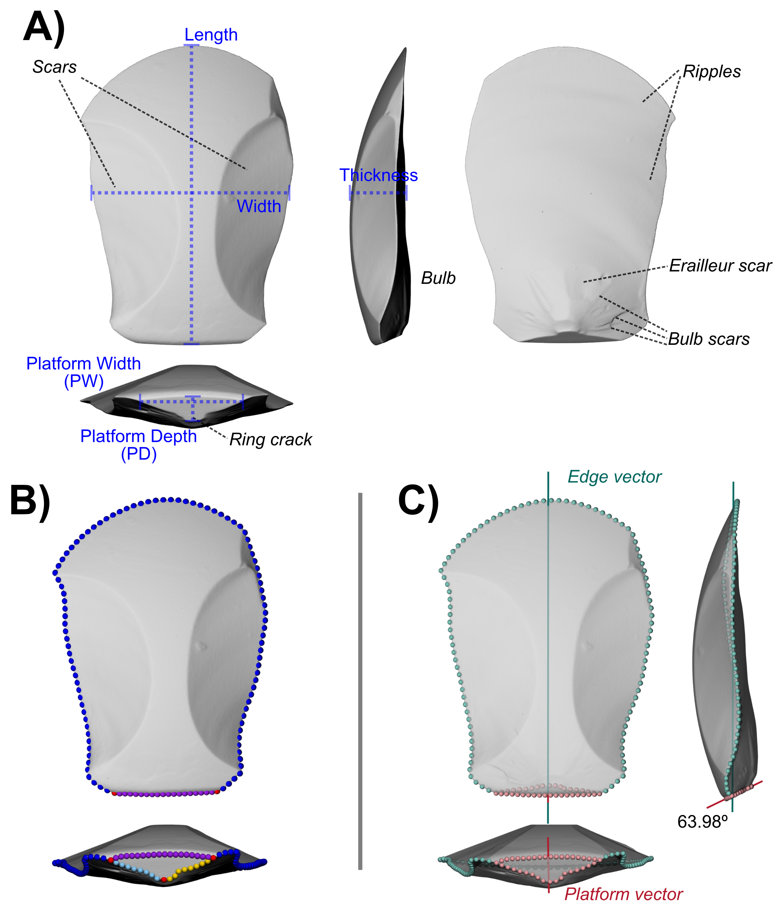

```{r setup, include=FALSE}
knitr::opts_chunk$set(echo = TRUE, message = FALSE, warning = FALSE)
```
```{r}
library(tidyverse); library(caret); library(kableExtra)
Digit_data2 <- read.csv("../Data/Data.csv")
Prim_Flakes <- Digit_data2 %>% filter(Flake_type == "Primary")
Sec_Flakes <- Digit_data2 %>% filter(Flake_type == "Secondary")
```
\  

$^{(1)}$ Departament of Human Origins, Max Planck Institute for Evolutionary Anthropology, Leipzig.   
$^{(2)}$ Institut Català de Paleoecologia Humana i Evolució Social (IPHES-CERCA), Zona Educacional 4, Campus Sescelades URV (Edifici W3), 43007 Tarragona, Spain.   
$^{(3)}$ Universitat Rovira i Virgili, Departament d’Història i Història de l’Art, Avinguda de Catalunya 35, 43002 Tarragona, Spain.   

<div align="justify">   

\ 

## **Abstract**   

Flakes are the primary component of lithic assemblages. Understanding the relationship between variables controlled by past knappers and flake mass is fundamental for reduction studies, understanding aspects of skill, learning, and technological design of stone tools. Mechanical flaking experiments indicate that platform depth (PD), exterior platform angle (EPA), and angle of blow (AOB) are the main determinants of flake mass and morphology. However, most of these mechanical experiments have been carried out using glass cores without scars from previous removals, whereas most archaeological flakes have complex scar patterns. Here we evaluate how well a model trained on primary flakes extends to flakes with scars from previous removals for the prediction of mass using the same mechanical flaking framework. We flaked glass hemisphere cores with varying platform depths and angles of blow (0º and 20º). Following these initial removals, flakes capturing the previous scars were removed (here termed “secondary flakes”). This allowed us to generate an experimental collection of `r count(Digit_data2[Digit_data2$Flake_type == "Primary",])` primary flakes and `r count(Digit_data2[Digit_data2$Flake_type == "Secondary",])` secondary flakes. Two approaches were used to determine how well the model generalizes to secondary flakes. First, a multiple linear regression was trained on the primary flakes and was then used to make flake mass predictions for the secondary flakes. A second multiple linear regression was trained with the secondary flakes. Both multiple linear regressions used the platform depth, the angle of blow and fracture angle as predictors. In both cases, the correlation and accuracy of the model derived on primary flakes decreased when applied to secondary flakes with the model tending to overestimate flake mass. The results suggest that current efforts to improve flake mass prediction through improvements of the existing variable set (PD, EPA and AOB) will continually over-estimate mass.     

\ 

**Key words:** flake formation; lithic analysis; experimental archaeology; controlled experiments.   

\ 

## **1. Introduction**    

Lithic flakes are present since the earliest stone tool industries [@braunEarliestKnownOldowan2019; @harmand33millionyearoldStoneTools2015; @plummerExpandedGeographicDistribution2023; @semawWorldsOldestStone2000], up until modern stone tool users [@casamiquelaTemasPatagonicosInteres1978a; @gallagherContemporaryStoneTools1977a; @gouldLivingArchaeologyNgatatjaraof1968; @haydenPaleolithicReflectionsLithic1979; @haydenStoneToolFunctions1977; @sillitoeLivingLithicsEthnoarchaeology2003a; @weedmanEthnoarchaeologicalStudyHafting2006a], and they are the main component of Paleolithic stone tools assemblages. The production of flakes informs about many aspects of past hominids: motor control and cognitive abilities [@kivellAustralopithecusSedibaHand2011; @marzkeToolMakingHand2013; @stoutNeuralCorrelatesEarly2008; @tothOldowanReassessedClose1985]; possible learning skills and levels of technicality among past groups and individuals [@geribasWhatNoviceKnappers2010; @lombaoTeachingMakeStone2017; @nonakaHowStoneKnappers2010; @pargeterTestingEffectLearning2023]; the evolution, internal variability and adaptation of different lithic techno-complexes through time and space [@debenathHandbookPaleolithicTypology1994; @kuhnEvolutionPaleolithicTechnologies2020; @rezekTwoMillionYears2018]; and site occupation patterns and raw material economy [@andrefskyRawMaterialAvailabilityOrganization1994; @bartonFormationLithicAssemblages2014; @kuhnFormalApproachDesign1994]. Therefore, understanding the variables that determine flake size and morphology is essential.

\ 

Understanding what determines flake mass in particular and how it relates to features controlled by the knapper has two major applications for the study of the past: technological design and reduction studies.  In technological design it can inform on what ranges of mass were targeted and how that mass was distributed among the flake (for example, very thick and asymmetric or flat flakes with acute edges). The distribution of mass and its relationship with other variables also affects studies focusing on knappers skill. Studies focusing on flake production according to skill level @nonakaHowStoneKnappers2010 showed that expert knappers are capable of detaching flakes from surfaces making an angle close to 90º, resulting in longer flakes, with a more usable edge, and with a more balanced distribution of mass per surface area.    

Reduction studies focus on predicting the original mass of scrapers. The Middle Paleolithic scraper reduction model [@dibbleInterpretationMiddlePaleolithic1987a; @dibbleMiddlePaleolithicScraper1995a], for instance, suggests that some stone tools can represent different stages of reuse and modification through retouch. This has important implications, as it makes scrapers proxies for understanding the organization of lithic technology of past groups [@andrefskyRawMaterialAvailabilityOrganization1994; @kuhnMousterianLithicTechnology1995; @shottCostsBenefitsTechnological2018]. Scrapers can then inform on the management of raw materials, the selection of morphologies for transport, mobility, site occupation patters, etc. Central to the reduction model is the concept of "curation", defined in lithic studies as “the ratio of realized to potential utility” [@shottExegesisCurationConcept1996; @shottUseLifeCuration2005]. This requires estimating what percentage of mass has been consumed by retouch, thereby making it necessary to estimate the original mass of a retouched tool. To estimate the curated ratio of a stone tool, lithic technology has sought an index that meets eight requirements [@hiscockGeneralizationInferenceQuantification2010]. These are: inferential power (being capable of accurately estimate the amount of mass lost); directionality (as reduction proceeds, so too does the value of the index); comprehensiveness (able to quantify mass lost along the complete reduction process); sensitivity (detect small differences in reduction); versatility (not affected by the different retouch patterns); blank diversity (not affected by the initial morphology of the flake); and size independence (not affected by the initial size of flakes).      

\ 

Mechanical flaking experiments have been key for understanding the specific determinants and their individual effects on flake morphological variability and size [@cotterellEssentialMechanicsConchoidal1985; @cotterellFormationFlakes1987; @cotterellMechanicsPreindustrialTechnology1990; @dibbleEffectHammerMass1995; @dibbleIntroducingNewExperimental2009a; @faulknerMechanicalPrinciplesFlintworking1972; @faulknerMechanicsEraillureFormation1973; @pelcinControlledExperimentsProduction1996; @pelcinEffectCoreSurface1997a; @pelcinEffectIndentorType1997; @pelcinFormationFlakesRole1997; @vanpeerMechanicalFrameworkConchoidal2021]. Standardized flake production (using homogeneous raw materials, standardized core morphology and flaking machines) allow control over individual variables, thereby making is possible to verify and quantify the individual effect of each variable, and importantly their interactions, on flake shape, size and additional features (e.g. platform lipping), along with providing information usually not available (such as force, hammer morphology, etc.).    

\ 

Research initiated in the 1980s by Harold Dibble and colleagues focused on exploring flake features measurable in the archaeological lithic record and controllable by knappers [@dibbleEffectHammerMass1995; @dibbleIntroducingNewExperimental2009a; @dibblePlatformVariabilityFlake1997; @pelcinControlledExperimentsProduction1996; @pelcinEffectCoreSurface1997a; @pelcinFormationFlakesRole1997]. In the context of controlled experiments, standardized glass cores and a flaking apparatus were used [@dibbleEffectHammerMass1995; @liSynthesisDibbleControlled2023], focusing on and individually modifying the platform depth (PD), external platform angle (EPA) and angle of blow (AOB). These three variables form the EPA+PD+AOB model [@liSynthesisDibbleControlled2023; @dibbleIntroducingNewExperimental2009a], which in controlled conditions has been demonstrated to determine a significant portion of flake morphological and size (mass) variability.  When estimating flake mass, the cube root of mass was used as the response variable. This transformation was applied because mass scales cubically, whereas key predictors of the model, such as PD, vary at a linear scale. Expressing mass as its cube root therefore places the response variable on a scale that is more directly comparable to the predictors and improves the modelling of their relationship [@liSynthesisDibbleControlled2023; @dibbleIntroducingNewExperimental2009a].   

\  

PD is easily  measurable in most flakes, and according to this model, increasing the PD will result in larger but also thicker flakes, with substantial mass being removed from the core. Increasing EPA, results in longer flakes, with larger surface areas relative to thickness, thus with less mass being removed from the core. There is an interaction between EPA and PD such that at higher EPAs, PD has a larger effect on flake size. How to measure EPA has been a source of disagreement among different analysts, with positions ranging from the rejection of this variable [@andrefskyLithicsMacroscopicApproaches2005], its use only when reference points are clear [@dibblePlatformVariabilityFlake1997], or proposals for alternative ways to measure EPA [@cochraneMeasurementAnalysisPlatform2003; @stoutUnderstandingOldowanKnapping2009]. However, despite these difficulties, controlled experiments show that this variable has an important effect on flake shape and size [@dibbleEffectHammerMass1995; @dibbleIntroducingNewExperimental2009a; @liSynthesisDibbleControlled2023; @pelcinControlledExperimentsProduction1996]. Additionally, hitting the core more obliquely (increasing the AOB) results in shorter and lighter flakes, and since the flake has a lower mass, the force required for its detachment diminishes [@liSynthesisDibbleControlled2023; @dibbleIntroducingNewExperimental2009a].   

\  

Despite its importance in flake prediction, when applying this model to the archaeological record AOB is usually dropped from the analysis because it could not be recorded on flakes. Recent approaches using controlled experiments and 3D measurements have shown that the AOB can change the angle of the Hertzian cone at the point of percussion and thus the angle of the Hertzian cone or bulb angle [@liQuantifyingKnappingActions2022] can be a proxy for AOB. The Hertzian cone is not visible on all flakes and even when present it is small and difficult to measure.  One approach is to simply use a goniometer directly on the flake.  Alternatively, the bulb angle can be measured from 3D models in at least two different ways.  One protocol involves passing a profile through the cone from which landmarks are extracted to calculate the bulb angle [@liQuantifyingKnappingActions2022]. Alternatively, there exists a virtual goniometer plugin for MeshLab which can capture this angle [@liQuantifyingKnappingActions2022; @yezzi-woodley2021; @cignoniMeshLabOpenSourceMesh2008]. Despite their different approaches, both 3D methods have produced consistent and accurate results, showing strong agreement with one another and successfully predicting AOB values [@liQuantifyingKnappingActions2022]. These results demonstrate that bulb angle measurements can serve as a reliable proxy for AOB, thereby enabling the estimation of this variable in archaeological assemblages and incorporating it to models predicting flake mass [@liDidEarlyPleistocene2023].    
 
\  

Thus while either form of the EPA+PD+AOB model is potentially of great importance in stone tool studies because it focuses on a small group of variables that can be analyzed in archaeological sites from almost all periods and regions, the actual application of the model to the archaeological record has not worked well enough.  The main issue is that flake predictions obtained under controlled conditions are not replicated under freehand experimental conditions where there is substantially more variability [@bustos-perezMultipleApproachesPredicting2022; @bustos-perezPredictingFlakeMass2021; @davisQuantifyingLithicCuration1998; @shottFlakeSizePlatform2000a]. Several approaches have been taken to try to improve the model’s predictive capacity. One approach has been to incorporate new variables, such as platform surface area [@shottFlakeSizePlatform2000a] or flake thickness [@bustos-perezPredictingFlakeMass2021; @dogandzicEdgeLengthSurface2015]. Another approach has been to improve how the key variables are recorded [@mullerNewMethodAccurately2016; @bustos-perezPredictingFlakeMass2021], including the use of improved digital measurements [@braunLandscapescaleVariationHominin2008; @clarksonEstimatingOriginalFlake2011].   

\ 

If, however, we return to the issue of aspects of variability in the archaeological record not tested in controlled conditions, one key aspect stands out.  In all of Dibble experiments, only a single, primary flake was extracted from each core and then the core was retired  [@dibbleIntroducingNewExperimental2009a; @liSynthesisDibbleControlled2023; @pelcinFormationFlakesRole1997]. There were practical reasons for this (i.e. the core design did not lend itself to multiple flakes from the same core), but also Dibble wanted the core surface morphology to be a constant in most of his experiments. In only one experiment [@rezekRelativeEffectsCore2011] did Dibble and colleagues address the impact of core surface morphology on flake outcomes. They molded glass cores which varied the basic Dibble et al. core morphology by adding different forms of ridges (parallel, convergent, center-ridge, divergent). Results from this experiment [@rezekRelativeEffectsCore2011] concluded that while core surface morphology does have some effect, PD, EPA and AOB remain the strongest predictors of flake size and shape.  This conclusion ran somewhat against the common view that the dorsal surface was an important determinant of flake morphology and mass. For instance, it is normally assumed that ridges from previous scars can act by guiding the fracture plane to generate more elongated elements (as observed in Upper Paleolithic blade productions) or very pronounced concavities from a previous scar can cause an early exit of fracture plane, resulting in a shorter or hinged flake. Thus, by excluding flakes with previous scars from experimental control, an important aspect of actual lithic variability has gone untested.   

\  

Thus the effects of the presence of previous flake scars has barely been explored and can be expected to have several effects on the EPA+PD+AOB model’s ability to predict flake mass [@pelcinControlledExperimentsProduction1996]. One possible scenario is that the model continues to predict well flake mass based on these three variables. Thus, when faced with a core surface with multiple flake scars, given a strike with a particular EPA, PD and AOB,  the flake would necessarily come off longer or wider (or perhaps thicker) in order to achieve the predicted final mass when mass is missing due to the flake scars.  Alternatively, the core surface morphology, modified by these scars, may act to direct the fracture plane further along the core surface (similar to perhaps how a blade core works) producing a flake with greater than predicted mass. In this scenario the current model would underestimate the mass of flakes with scars. A third scenario relates to the fact that platform width is not included in the standard model.  In some cases, previous flake removals along the same platform will mean that the platform is truncated and this might mean that the initiation of the flake fracture is altered in a way that impacts the resulting flake size, likely reducing it.  These last two scenarios obviously touch on the EPA+PD+AOB predictive capacity and could help explain why prediction in archaeological assemblages preforms less well. Thus here we report on controlled experiments on the effect of changes to the core surface morphology resulting from previous flake removals on the ability of the model to predict flake mass.   

\ 

## **2) Methods**    

### **2.1) Experimental setting and sample.** 

The experimental setup employed here uses the same machine described in the Dibble et al. mechanical flaking experiments  [@dibbleIntroducingNewExperimental2009a; @liSynthesisDibbleControlled2023]. This device consists of a pneumatic cylinder powered by compressed air and equipped with a rod assembly bearing a steel hammer tip. When activated, the rod assembly extends downward and strikes the glass core positioned below, replicating the “follow-through” motion of a flintknapper (Figure \@ref(fig:example-experimetns): A to C). The hammer is beveled following the specifications outlined in previous experimental designs [@dibbleIntroducingNewExperimental2009a; @liSynthesisDibbleControlled2023; @pelcinEffectIndentorType1997].    

\ 

We used hemispheres made of solid, optically clear K9 glass, commercially produced by Schreiber Glass. Each hemisphere has two surfaces: a flat surface corresponding to the equator of the sphere (serving as the percussion surface) and the curved exterior surface from which flakes were detached. We used cores with two different diameters: 8 cm and 10 cm. Although industrially manufactured, the cores show some variability in their initial dimensions and weight. On average, the 8 cm hemispheres weighed 277.64 ± 9.31 g and measured 3.6 ± 0.1 cm in height, while the 10 cm hemispheres weighed 561.75 ± 17.37 g and had an average height of 4.65 ± 0.2 cm. To standardize flake production, four core holders were designed in FreeCAD 1.0 (https://www.freecad.org/) and 3D‑printed: two for the 8 cm cores and two for the 10 cm cores. Each holder includes a cavity to position and secure the glass hemispheres, as well as a central front notch that allows flakes to detach freely (Figure \@ref(fig:example-experimetns): D and E). For each core size, one holder was designed to maintain a horizontal orientation, providing an AOB of 0°, whereas a second holder was designed to provide an AOB of 20°. Three C‑clamps and a rectangular metal spacer were used to evenly press and immobilize the core, with a piece of leather placed between the metal spacer and the glass to cushion and improve pressure distribution.    

\ 

```{r example-experimetns, fig.cap="Example of some of the mechanical flaking experiments. A to C) Frames from a slow motion video showing the detachment of a secondary flake. D) Preparation and placement of the core prior to the detachment of a secondary flake (note that the tip of the hammer touches the core in order to determine the PD of the flake and then is raised before striking off the flake). E) Example of a mechanically produced secondary flake.  In each of these examples the color comes from paint used to improve the scanning characteristics of the otherwise clear glass.", fig.width=6.5, fig.dpi=600, dev="png"}

```

\ 

The first flaking sequence was aimed at producing flakes without scars from previous removals (termed “primary flakes” following Sullivan and Rozen @sullivanDebitageAnalysisArchaeological1985). This was achieved by rotating the cores in the holder and spacing the points of percussion widely enough to prevent any overlap between removals (Figure \@ref(fig:example-materials)). The second sequence focused on producing flakes that captured scars from previous removals (termed “secondary flakes” also following Sullivan and Rozen @sullivanDebitageAnalysisArchaeological1985). For these, the hammer tip was positioned to strike in the space between previous detachments. As a result, most secondary flakes captured earlier scars on both lateral margins, while retaining a portion of the original convex core surface in the center. Importantly too, we made sure that the platform depth was not impacted by previous removals (though the platform width could be).  Both flaking sequences were conducted using the same AOB. Thus, if all flakes in the first sequence were produced with an AOB of 0°, the second sequence was also carried out with an AOB of 0°, and the same applied for the 20° condition.  Failed removals and flakes fragmented during detachment were excluded from the dataset. Only complete flakes preserving the morphological and metric attributes necessary for the analyses, and exhibiting the characteristic features of conchoidal fracture (ring crack, bulb of percussion, ripple marks, etc.) were included, ensuring consistent measurement of all variables.  On average, each core yielded between 4 and 5 flakes of each type.    

\ 

```{r flakes-dist, tab.cap="Flake type counts according to core size and AOB.  Hemisphere08 and Hemisphere10 refer to the diameters of the cores."}

Digit_data2 %>% 
  group_by(Flake_type, coretype, factor(aob)) %>% 
  summarise(
    count = n()
  ) %>% 
  kable(col.names = c("Flake type", "Core size", "AOB", "n"))
```

\ 

The experimental collection of primary flakes consisted of a sample of `r nrow(Prim_Flakes)` flakes (Table \@ref(tab:flakes-dist)). Flake mass among this experimental collection varied with an average value of `r round(mean(Prim_Flakes$fweight), 3)` g (cube root value of `r round(mean(Prim_Flakes$mass_cube), 3)`), with a maximum value of `r round(max(Prim_Flakes$fweight), 3)` g, while the smallest flake weighed only `r round(min(Prim_Flakes$fweight), 3)` g. The standard deviation of the cube root of flake mass was `r round(sd(Prim_Flakes$mass_cube), 3)`. The primary flakes included in this study were previously reported [@bustos-perezRulesAreRules2026]. That assemblage showed a high degree of reproducibility with earlier experimental studies based on mechanically produced flakes [@dibbleIntroducingNewExperimental2009a; @leaderEffectsPlatformBeveling2017; @linControllingLevalloisEffect2025; @linMediatingEffectPlatform2022a; @linUtilityEconomizationUnretouched2013; @rezekRelativeEffectsCore2011; @liSynthesisDibbleControlled2023], supporting the reliability of the experimental protocol and the resulting morphological and metric patterns. As the mechanical flaking experiments continued after the publication of that study as part of the broader experimental program, the number of primary flakes included here differs slightly from what we previously reported [@bustos-perezRulesAreRules2026].   

\  

```{r example-materials, fig.cap="Example of flakes from both experimental collections. Top row: flakes from the Hemisphere dataset obtained during the first round of flaking. Bottom row: flakes capturing scars from previous removals during the second round of detachment.", fig.width=6.5, fig.dpi=600, dev="png"}

```

\  

The second round of flake production provided an experimental collection of `r nrow(Sec_Flakes)` secondary flakes with scars (Table \@ref(tab:flakes-dist)). Flake mass among the secondary flakes (Table \@ref(tab:desc-stat-flakes)) varied with an average of `r round(mean(Sec_Flakes$fweight), 3)` g (cube root of `r round(mean(Sec_Flakes$mass_cube), 3)`). The biggest flake of this experimental collection weighed `r round(max(Sec_Flakes$fweight), 3)` g, while the smallest flake weighed `r round(min(Sec_Flakes$fweight), 3)` g. The standard deviation of cube root of flake mass was `r round(sd(Sec_Flakes$mass_cube), 3)` for this experimental collection (Table \@ref(tab:desc-stat-flakes)).   

\ 

```{r desc-stat-flakes, tab.cap="Descriptive statistics of flake mass and cube-root-transformed mass for the experimental assemblage of mechanically produced flakes."}

rbind(
  (
    Digit_data2 %>% 
      group_by(Flake_type) %>% 
      summarise(
        count =n (),
        min_mass = min(fweight),
        first_q = quantile(fweight, 0.25),
        meadian = quantile(fweight, 0.5),
        mean_mass = mean(fweight),
        fthird_q = quantile(fweight, 0.75),
        max_mass = max(fweight))
  ),
  (
    Digit_data2 %>% 
      group_by(Flake_type) %>% 
      summarise(
        count = n(),
        min_mass = min(mass_cube),
        first_q = quantile(mass_cube, 0.25),
        meadian = quantile(mass_cube, 0.5),
        mean_mass = mean(mass_cube),
        fthird_q = quantile(mass_cube, 0.75),
        max_mass = max(mass_cube)) 
  )) %>% 
  kable(col.names = c("Flake type", "n", "Min", "1st Q", "Median",
                      "Mean", "3rd Q", "Max"), digits = 3)
```

\ 

### **2.2) Attribute analysis and 3D landmarking**      

All flakes were scanned using an Artec Micro II and exported to PLY format. Because glass flakes are transparent, structured‑light scanning cannot reliably capture their geometry. To address this, each flake was spray‑painted with acrylic paint prior to scanning. This coating provides long‑term durability, creates an opaque surface suitable for structured‑light acquisition, and preserves the fine morphological features characteristic of conchoidal fracture (e.g., eraillure scars, bulbs, ripples; Figure \@ref(fig:sec-flake-measures): A). Following acquisition, the meshes were decimated to 200,000 faces using the Rvcg R package v.0.25 [@schlagerMorphoRvcgShape2017]. All scans were visually inspected in Meshlab v.2025.07 [@cignoniMeshLabOpenSourceMesh2008]. A total of 143 landmarks were placed in order to extract accurate measures of flake features (Bookstein, 1997a, 1997b; Gunz et al., 2005; Gunz and Mitteroecker, 2013). These landmarks correspond to: three fixed landmarks (point of percussion and both laterals of the platform); 40 landmarks defining the outline of the platform (10 for the left interior platform curve, 20 for the exterior platform curve, and 10 for the right interior platform curve); and 100 landmarks for the flake edge (Figure \@ref(fig:sec-flake-measures): B). All curve‑based landmarks were positioned at equal intervals along their respective curves. Landmarking was performed in Viewbox v.4.1.5.2 (https://www.dhal.com/viewbox.htm). To guide the placement of landmarks and semilandmarks, a template/atlas was created using an arbitrarily selected flake from the Dibble et al. experimental collection. Prior to extracting measurements from landmarks, all flakes were rotated without scaling using the package Morpho v.2.12 [@schlagerMorphoRvcgShape2017]. For all flakes, the following variables were obtained (manual recording was used to maintain comparability with earlier experiments; Figure \@ref(fig:sec-flake-measures): A):   

* Platform depth (PD): measured with a digital caliper (precision of 0.01 mm) from the point of percussion to the exterior surface of the platform.    

* Platform width (PW): measured with a digital caliper (precision of 0.01 mm) from one lateral extremity of the platform edge to the other.    

* Platform surface interior angle (PSIA): defined as the angle formed by the platform width extremities and the point of percussion [@mcpherronIntroducingPlatformSurface2020]. Measured digitally by the use of the corresponding landmarks.   

* Platform surface area: measured in $mm^2$ on the 3D meshes and defined as the area enclosed by the landmarks of the three curves of the platform.    

* Length: measured with a digital caliper (precision of 0.01 mm) from the point of percussion to the most distal point on the flake edge.   

* Width: measured with a digital caliper (precision of 0.01 mm) at the midpoint of the length axis of the flake and perpendicular to it.   

*	Thickness: measured with a digital caliper (precision of 0.01 mm) at the midpoint of the length axis of the flake.    

* Angle of blow (AOB): fixed by the 3D printed core holder with two possible values (0º and 20º).   

* Fracture angle: the angle in degrees formed between the landmarks placed along the flake edge and those defining the platform perimeter (Figure \@ref(fig:sec-flake-measures): C).   

* Mass: measured on a digital scale with a precision of 0.01 g.   

\ 

```{r sec-flake-measures, fig.cap="3D scan of a secondary flake. A) Example of manual attributes measured from the flakes. B) Landmarking protocol. C) Fitting of the regression vectors to obtain the fracture angle", fig.width=6.5, fig.dpi=600, dev="png"}

```

\ 

### **2.3) Regression analysis and model comparison**     

The cubic root of mass is used as the variable to be predicted. This is done to obtain a linear relationship between PD and mass and to facilitate comparison with previous results [@dibbleIntroducingNewExperimental2009a; @dogandzicEdgeLengthSurface2015; @liSynthesisDibbleControlled2023]. PD, AOB and fracture angle serve as predictive variables. For the three regression models, fracture angle is employed as a substitute of EPA. As noted previously, how to measure EPA has been a source of disagreement between analysts [@andrefskyLithicsMacroscopicApproaches2005; @dibblePlatformVariabilityFlake1997; @cochraneMeasurementAnalysisPlatform2003; @stoutUnderstandingOldowanKnapping2009]. This difficulty arises because flakes may exhibit a curved cortical dorsal surface or, in the absence of cortex, an irregular topography generated by previous flake scars or platform beveling. In addition, the  platform itself may present surface irregularities. Together, these factors can obscure the reference points required for EPA measurement, increasing inter-observer variability and reducing measurement reliability. The experimental cores employed in this study have a consistently curved surface, which results in continuous variation across the dorsal surface of flakes. This design intentionally simulates situations in which EPA cannot be measured with confidence. Using fracture angle in place of EPA therefore allows the models to evaluate flake formation under conditions that mirror many archaeological contexts where EPA is obscured or distorted.     

\ 

Two models are trained to estimate the cube root of flake mass: one using flakes without previous scars (primary flakes), and a second model using flakes with scars (secondary flakes). All models were trained using a multiple linear regression and evaluated through the leave one out cross validation system. The multiple linear regression extends the linear regression in such a way that it can directly accommodate multiple predictors [@jamesIntroductionStatisticalLearning2013]. In the leave one out cross validation system, each row of a data set serves as a test set, while the rest serve as a training set. As a result of this method, the same number of models as the sample size are trained and the accuracy metrics are extracted from each of the rows that served as test sets. This approach reduces the bias of the model and ensures model results.    

\  

From these two models, three types of predictions are obtained. The first group of predictions comes from the model trained on the primary flakes predicting those same flakes. This model is equivalent to those developed in previous experiments [@dibbleIntroducingNewExperimental2009a; @liSynthesisDibbleControlled2023] and serves as a baseline reference for models trained using primary flakes (without previous scars). The second group of predictions comes from applying the primary flake model to predict the flake mass (cube root) of secondary flakes. This approach allows us to evaluate whether the predictive performance of models trained on primary flakes can be reliably extended to secondary flakes and to assess whether any systematic bias emerges in these predictions. The third group of predictions comes from a model trained on the secondary flakes and used to predict the mass (cube root) of the same secondary flakes. This provides a direct comparison with the previous two models (and their predictions) and allows us to determine whether the presence of scars affects the ability of the selected variables (PD, AOB and fracture angle) to predict flake mass.    

\ 

The accuracy of the predictions of the three groups was compared using four metrics: $r^2$, MAE, RMSE and MAPE. $r^2$ quantifies the strength of the linear correlation and indicates the proportion of observed variation accounted for by the model. The addition of predictors results in  increasing
$r^2$ values, irrespective of predictor contribution to the model and making it impossible to compare models with a different number of predictors. The adjusted $r^2$ is analogous to the linear regression, but adjusted to the number of predictors, making possible comparisons of models with different numbers of predictors. All $r^2$ values reported here correspond to the adjusted $r^2$. In lithic studies, $r^2$ values have been used to classify the predictive power of indices [@hiscockGeneralizationInferenceQuantification2010], with values below 0.1 considered low, 0.1–0.25 moderate, 0.26–0.5 fairly large or strong, 0.51–0.8 very large or strong, and values above 0.8 regarded as extremely large or strong. Nevertheless, it should be noted that data sets with differing distributions may yield identical or similar $r^2$ values [@anscombeGraphsStatisticalAnalysis1973]. Because of this, multiple studies focused on predicting original flake mass favor other measures of precision [@bustos-perezFindingOriginalMass2025; @bustos-perezMultipleApproachesPredicting2022; @bustos-perezPredictingFlakeMass2021].       

\ 

The mean average error (MAE) and root mean squared error (RMSE) provide summary values of how far predictions fall from the true value [@jamesIntroductionStatisticalLearning2013; @lantzMachineLearningExpert2019]. The mean absolute error (MAE) measures the average magnitude of prediction errors, regardless of their direction. The root mean square error (RMSE) similarly quantifies the deviation between predicted and observed values but assigns greater weight to larger errors. RMSE is often evaluated relative to the standard deviation (SD) of the predicted variable. When the RMSE is lower than the SD, the model performs better than a simple mean‑based prediction. An ideal model would produce MAE and RMSE values of zero, and in practice, lower values for both metrics indicate better predictive performance. The mean absolute percentage error (MAPE) quantifies prediction error relative to the observed values by expressing it as a percentage [@demyttenaereMeanAbsolutePercentage2016]. It indicates the average percentage deviation of the predicted values from the corresponding actual values, facilitating the interpretation of model accuracy in relative terms.   

\ 

A regression plot displays the relationship between predicted and observed values, along with the fitted regression line. In a well‑performing model, this line should pass through the center of all points, which should be distributed evenly above and below it. The plot also includes an identity line, representing perfect agreement between observed and predicted values. Comparing the regression line to this identity line makes it possible to detect systematic biases across the prediction range.    

\ 

The analysis of residuals is essential for identifying potential biases in model predictions. To this end, a visual exploratory assessment of the residuals was conducted. First, the overall density distribution of the residuals was examined. In an unbiased model, residuals should peak around the zero value and display a roughly symmetrical distribution on both sides. Residual plots were then used to compare residuals with the predicted values of cube root of flake mass. Examining residuals in relation to predicted mass allows us to identify the direction of any bias. For example, if residual values decrease with predicted flake mass, this would indicate that the model systematically overestimates the mass of larger flakes. In an ideal plot, residuals should be evenly distributed along the 0 axis. Additional to the residual plots, residuals were regressed on predicted values. If the estimate of the predicted value for this regression is not equal to zero, this indicates that the model has systematic bias across the prediction range [@jamesIntroductionStatisticalLearning2013].   

\ 

In the EPA+PD+AOB model, PD has the largest effect size, and controlled experiments typically show a strong correlation between PD and mass. For this reason, residuals were also examined as a function of PD to determine whether prediction errors vary systematically with changes in PD. As with the predicted values, the estimate of PD when predicting residuals should be equal or close to zero. Otherwise, this indicates that the model has systematic bias across the range of PD values. This allows us to determine whether there are error biases in the prediction as PD values change. The residual plots were generated for all three prediction groups (primary‑to‑primary; primary‑to‑secondary; and secondary-to-secondary).

Previous research has shown that initial core size, together with PD and AOB, can influence the amount of mass detached by a flake  [@bustos-perezRulesAreRules2026]. To evaluate whether this variable affected model performance, residual distributions were examined according to core size through the three groups of predictions.     

\ 

In addition to evaluating model performance, the effect of previous scars on flake linear measurements was examined. To do this, linear measurements were analysed in relation to platform depth and AOB. For each measurement, multiple linear regressions were then fitted using the same predictors employed for flake mass, with the addition of flake type. This approach makes it possible to assess the specific contribution of flake type and to evaluate how the presence of dorsal scars alters the coefficient values, thereby identifying which linear dimensions are most affected by previous removals.    

\  

The complete analysis workflow was performed using the R programming language v.4.4.1 in RStudio IDE v.2025.05.01 [@rcoreteamLanguageEnvironmentStatistical2019; @rstudioteamRStudioIntegratedDevelopment2019]. Data processing, transformation and plotting was done using the *tidyverse* package v.2.0.0 [@wickhamWelcomeTidyverse2019]. Model training, and predictions were done using the *caret* v.7.0.1 package [@kuhnBuildingPredictiveModels2008].   

\  

```{r include=FALSE}

library(tidyverse); library(caret)

tr_Control <- trainControl(
  verboseIter = TRUE,
  method = "LOOCV",
  savePredictions = "final")
frmla1 <- as.formula("mass_cube ~ platthick + factor(aob) + frac_angle")


#### Train multiple linear regression ###
MLR_Prim <- train(
  frmla1,
  data = Prim_Flakes,
  method = "lm",
  trControl = tr_Control
)

MLR_Sec <- train(
  frmla1,
  data = Sec_Flakes,
  method = "lm",
  trControl = tr_Control
)

###
Sec_Flakes <- Sec_Flakes %>% 
  mutate(
    pred_from_prim =  predict(MLR_Prim, Sec_Flakes),
    pred_from_sec = predict(MLR_Sec, Sec_Flakes),
    Res_Prim = mass_cube - pred_from_prim,
    Res_Sec = mass_cube - pred_from_sec)

base_res <- MLR_Prim$pred %>% mutate(
  Residuals = obs - pred ) %>%
  mutate(Model = "Base_model") %>% 
  select(Model, Residuals)

Res_Allmodels <- Sec_Flakes %>% 
  mutate(
    pred_from_prim =  predict(MLR_Prim, Sec_Flakes),
    pred_from_sec = predict(MLR_Sec, Sec_Flakes),
    Res_Prim = mass_cube - pred_from_prim,
    Res_Sec = mass_cube - pred_from_sec) %>% 
  select(Res_Prim, Res_Sec) %>% 
  pivot_longer(cols = c(Res_Prim, Res_Sec),
               names_to = "Model",
               values_to = "Residuals") 

Res_Allmodels <- rbind(Res_Allmodels, base_res)

Prim_Flakes <- Prim_Flakes %>% 
  mutate(
    pred_prim_to_prim = MLR_Prim$pred$pred
  ) %>% 
  mutate(res_prim_to_prim = mass_cube - pred_prim_to_prim)
```

## **3) Results**    

### **3.1) Model evaluation and bias**   

Figure \@ref(fig:reg-plots) presents the regression plots for the three groups of predictions (primary-to-primary; primary-to-secondary; secondary-to-secondary). All three groups of predictions seem to present a good fit, with the points distributed evenly on both sides of their respective regression lines.   

\  

Comparing the regression line with the identity line across the different prediction groups reveals model‑specific differences in calibration (Figure \@ref(fig:reg-plots)). For the model trained on primary flakes and used to predict primary flakes, the regression and identity lines lie very close to one another. At the lower end of the flake‑mass range, the regression line sits slightly above the identity line, indicating minor overpredictions, whereas at higher masses it falls slightly below the identity line, indicating small underpredictions. When the model trained on primary flakes was applied to secondary flakes, the regression and identity lines are the closest of the three models. This suggests that the model maintains good calibration across the full range of flake‑mass values, even when predicting flakes with scars. The model trained and tested on secondary flakes showed the greatest deviation between the regression and identity lines. This pattern indicates that this model tends to overestimate the mass of smaller flakes and underestimate the mass of larger flakes, reflecting the strongest systematic bias among the three prediction groups.    

\  

```{r reg-plots, fig.cap="Regression plots when estimating flake mass from the either primary flakes or from secondary flakes.", fig.width=6.5, fig.height=7, fig.dpi=600, dev="png"}

ggpubr::ggarrange(
  (
    as.data.frame(MLR_Prim$pred) %>% 
  ggplot(aes(obs, pred)) +
  geom_point(fill = "darkgreen", shape = 21) +
  coord_fixed() +
  theme_light() +
  labs(title = "Trained and predicting on primary flakes",
       x = "Observed flake mass (cube root)",
       y = "Predicted mass (cube root)") + 
  scale_x_continuous(breaks = seq(0, 3, 0.2), limits = c(0.8,2.9)) +
  scale_y_continuous(breaks = seq(0, 3, 0.2), limits = c(0.8,2.9)) +
  geom_smooth(method='lm', se = FALSE) +
  geom_abline(linetype = "dashed") +
  
  theme(
    axis.text = element_text(size = 7, color = "black"),
    axis.title = element_text(size = 8, color = "black", face = "bold"),
    plot.title = element_text(size = 7, color = "black", face = "bold"))
  ),
  
  (Sec_Flakes %>% ggplot(aes(mass_cube, pred_from_prim)) +
     geom_point(fill = "#007BA7", shape = 21) +
     coord_fixed() +
     theme_light() +
     labs(title = "Trained on primary flakes, predicting on secondary flakes",
          x = "Observed flake mass (cube root)",
          y = "Predicted mass (cube root)") + 
     scale_x_continuous(breaks = seq(0, 3, 0.2), limits = c(0.8,2.9)) +
     scale_y_continuous(breaks = seq(0, 3, 0.2), limits = c(0.8,2.9)) +
     geom_smooth(method='lm', se = FALSE) +
     geom_abline(linetype = "dashed") +

     theme(
       axis.text = element_text(size = 7, color = "black"),
       axis.title = element_text(size = 8, color = "black", face = "bold"),
       plot.title = element_text(size = 7, color = "black", face = "bold")
     )
  ),
  
  (
    Sec_Flakes %>% ggplot(aes(mass_cube, pred_from_sec)) +
      geom_point(fill = "#CD5C5C", shape = 23) +
      coord_fixed() +
      theme_light() +
      labs(title = "Trained and predicting on secondary flakes",
           x = "Observed flake mass (cube root)",
           y = "Predicted mass (cube root)") + 
      scale_x_continuous(breaks = seq(0, 3, 0.2), limits = c(0.8,2.9)) +
      scale_y_continuous(breaks = seq(0, 3, 0.2), limits = c(0.8,2.9)) +
      geom_smooth(method = "lm", se = FALSE) +
      geom_abline(linetype = "dashed") +
      theme(
        axis.text = element_text(size = 7, color = "black"),
        axis.title = element_text(size = 8, color = "black", face = "bold"),
        plot.title = element_text(size = 7, color = "black", face = "bold")
      )
  )
)
```

\ 

Analysis of the model coefficients provides insight into how each variable contributes to the amount of mass removed by a flake. All three variables were significant for estimating flake mass in both models. In the model trained on primary flakes, PD had an estimated coefficient of `r round(MLR_Prim$finalModel$coefficients[[2]], 2)`, whereas in the model trained on secondary flakes the PD estimate was `r round(MLR_Sec$finalModel$coefficients[[2]], 2)`. This indicates that, for the same PD value, secondary flakes will have less mass than primary flakes. The AOB shows a negative relationship in both models, with more oblique detachments (higher AOB values) producing flakes with less mass. However, the magnitude of this effect differs between models. In the primary‑flake model, flakes detached at an AOB of 20° have a cube‑root mass that is `r abs(round(MLR_Prim$finalModel$coefficients[[3]], 2))` units lower than flakes detached at 0°.  In the secondary‑flake model, the AOB coefficient is roughly half as large (`r abs(round(MLR_Sec$finalModel$coefficients[[3]], 2))`), indicating a weaker effect. This suggests that although oblique detachments also reduce the mass of secondary flakes, the reduction is less pronounced (likely because secondary flakes already contain less available mass due to scars from previous removals). Both models produced nearly identical coefficient estimates for fracture angle (`r round(MLR_Prim$finalModel$coefficients[[4]], 2)`). In the hemisphere cores, shorter flakes tend to have higher fracture‑angle values because the fracture exits the core earlier, whereas longer flakes penetrate deeper into the core, increasing flake curvature and thereby reducing the fracture angle value. This relationship is consistent across both primary and secondary flakes.

\ 

Table \@ref(tab:model-results) presents the percentage of variance explained by each group of predictions and their precision metrics. The baseline model (primary-to-primary) explained the highest percentage of variance, presenting a extremely strong relationship with the outcome. The RMSE (`r round(MLR_Prim$results[[2]], 3)`) of this model was more than 2.5 times lower than the standard deviation of the outcome `r round(sd(Prim_Flakes$mass_cube), 3)`, indicating a very good fit and that the predictions are not far from the actual value.     

\ 

However, when this model is applied to predict the flake mass (cube root) of the secondary flakes, all evaluation metrics worsen. The $r^2$ explained the smallest percentage of variance of the three groups of predictions (`r round(summary(lm((Sec_Flakes$mass_cube ~ Sec_Flakes$pred_from_prim)))$r.squared, 3)`), although it remained strong. The RMSE and MAE presented the highest values of the three groups of predictions (`r round(caret::MAE(Sec_Flakes$mass_cube, Sec_Flakes$pred_from_prim),3)` and `r round(caret::RMSE(Sec_Flakes$mass_cube, Sec_Flakes$pred_from_prim),3)` respectively), and average percent error (MAPE) regarding observed flake mass was also the highest. This indicates the largest magnitude of errors among the three groups of predictions. When the RMSE is compared to the standard deviation of the cube root of the mass of the secondary flakes (`r round(sd(Sec_Flakes$mass_cube), 2)`), it is only `r round((sd(Sec_Flakes$mass_cube))/caret::MAE(Sec_Flakes$mass_cube, Sec_Flakes$pred_from_prim), 2)` times smaller, marking a substantial difference regarding the predictions on primary flakes.    

\ 

The secondary-to-secondary group of predictions presented mixed results. On the one hand, the percentage of variance explained is similar to the one obtained when using the primary flakes to predict the mass of the secondary flakes `r round(summary(lm((Sec_Flakes$mass_cube ~ Sec_Flakes$pred_from_sec)))$r.squared, 3)`. However, the accuracy metrics of predictions (RMSE, MAE and MAPE) fall in between the other two groups of predictions (`r round(caret::MAE(Sec_Flakes$mass_cube, Sec_Flakes$pred_from_sec), 3)`; `r round(caret::RMSE(Sec_Flakes$mass_cube, Sec_Flakes$pred_from_sec), 3)` respectively).    

\ 

```{r model-results, tab.cap="Variance explained and precision metrics for each of the models"}
tibble(
  Model_to_data = c("Primary to primary", "Primary to secondary", "Secondary to secondary"),
  r2 = c(round(MLR_Prim$results[[3]], 3),
         round(summary(lm((Sec_Flakes$mass_cube ~ Sec_Flakes$pred_from_prim)))$r.squared, 3),
         round(summary(lm((Sec_Flakes$mass_cube ~ Sec_Flakes$pred_from_sec)))$r.squared, 3)),
  
  MAE = c(round(MLR_Prim$results[[4]], 3), 
          round(caret::MAE(Sec_Flakes$mass_cube, Sec_Flakes$pred_from_prim),3),
          round(caret::MAE(Sec_Flakes$mass_cube, Sec_Flakes$pred_from_sec), 3)),
  
  RMSE = c(round(MLR_Prim$results[[2]], 3), 
           round(caret::RMSE(Sec_Flakes$mass_cube, Sec_Flakes$pred_from_prim),3),
           round(caret::RMSE(Sec_Flakes$mass_cube, Sec_Flakes$pred_from_sec), 3)),
    MAPE = c(
    Metrics::mape(MLR_Prim$pred$obs, MLR_Prim$pred$pred)*100,
    Metrics::mape(Sec_Flakes$mass_cube, Sec_Flakes$pred_from_prim)*100,
    Metrics::mape(Sec_Flakes$mass_cube, Sec_Flakes$pred_from_sec)*100
  )) %>% kable(col.names = c("Trained on, to predict", "r2", "MAE", "RMSE", "MAPE"), digits = 3)

```

\ 

The average value of the residuals is very similar, with values close to 0 in all three cases. However, visual exploration of the residuals through density curves (Figure \@ref(fig:dens-plots)) shows significant differences in how the residuals are distributed across the three models. The density curve of the reference model shows a clear peak close to the zero, although slightly shifted toward negative values (indicating a tendency to overestimate the flake mass). 50% of the residuals from the reference model are distributed between `r round(quantile((MLR_Prim$pred$obs - MLR_Prim$pred$pred), 0.25), 2)[[1]]` and `r round(quantile((MLR_Prim$pred$obs - MLR_Prim$pred$pred), 0.75), 2)[[1]]`, which is the narrowest distribution range of the three models.    

\ 

The density curve of the residuals obtained from the primary-to-secondary model showed the least pronounced peak of the three groups of predictions, although the residuals are normally distributed (W =`r round(quantile(Sec_Flakes$Res_Prim, 0.25), 2)[[1]]`; *p* = `r round(quantile(Sec_Flakes$Res_Prim, 0.75), 2)[[1]]`). The peak of this density curve is also slightly shifted toward negative values, indicating a tendency to overestimate the mass of the secondary flakes when making predictions. As a result of this distribution, the residuals of these predictions have the widest range, with 50% of them falling between the `r round(quantile(Sec_Flakes$Res_Prim, 0.25), 2)[[1]]` and `r round(quantile(Sec_Flakes$Res_Prim, 0.75), 2)[[1]]` values.   

\ 

The density curve of the residuals obtained from the model trained using the secondary flakes to predict on those same flakes presents a good distribution. This density curve is symmetrically distributed around the 0 value, although it presents a very wide profile. 50% of the residuals for this model are comprised between the `r round(quantile(Sec_Flakes$Res_Sec, 0.25), 2)[[1]]` and `r round(quantile(Sec_Flakes$Res_Sec, 0.75), 2)[[1]]`, indicating a slightly better fit than the model trained on the primary flakes and predicting on the secondary flakes. Residuals from this model are also normally distributed (W = `r round(shapiro.test(Sec_Flakes$Res_Sec)$statistic[[1]], 2)`; *p* = `r round(shapiro.test(Sec_Flakes$Res_Sec)[[2]], 2)`).    

\ 

```{r dens-plots, fig.cap="Scaled density plots of residual distribution among the three models", fig.width=6.5, fig.height=3.5, fig.dpi=600, dev="png"}
Res_Allmodels %>% 
  ggplot() +
  geom_density(aes(Residuals, color = Model)) +
  theme_light() +
  scale_color_manual(values = c("darkgreen", "#007BA7", "#CD5C5C"),
                     labels = c("Primary to primary", "Primary to secondary", "Secondary to secondary")) +
  ylab("Density") +
  geom_vline(xintercept = 0, linetype = "dashed") +
  geom_hline(yintercept = 0, linetype = "solid") +
  theme(
    legend.position = "bottom",
    axis.text = element_text(size = 7, color = "black"),
    axis.title = element_text(size = 8, color = "black", face = "bold"),
    legend.title = element_text(size = 8.5, color = "black"),
    legend.text = element_text(size = 8, color = "black")
  )
```

\  

Figure \@ref(fig:res-plots) presents the distribution of residuals according to the predicted value of mass (cube root) and PD. In the case of residuals according to the predicted value, differences in the distribution of the residuals are observed depending on the model. In the case of the model trained using primary flakes, the residuals are distributed symmetrically around the value 0. When the residuals of the primary-to-primary flakes are regressed on the predicted values, an estimate of `r round(summary(lm(base_res$Residuals ~ MLR_Prim$pred$pred))$coefficients[2,1],2)` is obtained. This indicates that there is no bias along the range of predictions for the baseline model. The primary-to-secondary predictions present a much different distribution. When flakes are predicted to have a cube root mass above the value of 2, negative residuals are almost systematically obtained. When the primary-to-secondary residuals  are regressed on the predicted values, an estimate value of `r round(summary(lm(Sec_Flakes$Res_Prim ~ Sec_Flakes$pred_from_prim))$coefficients[2,1],2)` is obtained. This is indicative of a systematic bias along the predicted range, indicating that the larger the flake, the more its mass gets overestimated. The secondary-on-secondary residuals are symmetrically distributed around the value 0. The regression of residuals on predicted values resulted on a coefficient estimate of `r round(summary(lm(Sec_Flakes$Res_Sec ~ Sec_Flakes$pred_from_sec))$coefficients[2,1],2)`, which indicates no systematic bias along the range of predictions.    

\ 

```{r res-plots, fig.cap="Residual distribution according to predicted flake mass and flake PD for the three groups of predictions", fig.width=6.5, fig.height=7, fig.dpi=600, dev="png"}
ggpubr::ggarrange(
  
  # First row title
  ggplot() +
    theme_void() +
    labs(title = "Trained and predicting on primary flakes") +
    theme(
      plot.title = element_text(
        hjust = 0.5, face = "bold", size = 8
      ),
      plot.margin = margin(0, 0, 0, 0)
    ),
  
  # First row plots
  ggpubr::ggarrange(
    as.data.frame(MLR_Prim$pred) %>% 
      mutate(residual = obs - pred) %>% 
      ggplot(aes(pred, residual)) +
      geom_hline(yintercept = 0, linetype = "dashed") +
      geom_point(fill = "darkgreen", shape = 21) +
      theme_light() +
      labs(
        x = "Predicted mass (cube root)",
        y = "Residuals"
      ) +
      scale_y_continuous(breaks = seq(-0.5, 0.5, 0.1), limits = c(-0.5, 0.52)) +
      scale_x_continuous(breaks = seq(0, 2.6, 0.2), limits = c(0.9, 2.6)) +
      theme(
        axis.text = element_text(size = 7, color = "black"),
        axis.title = element_text(size = 8, color = "black", face = "bold")
      ),
    
    Prim_Flakes %>% 
      mutate(res = MLR_Prim$pred$obs - MLR_Prim$pred$pred) %>% 
      ggplot(aes(platthick, res)) +
      geom_hline(yintercept = 0, linetype = "dashed") +
      geom_point(fill = "darkgreen", shape = 21) +
      theme_light() +
      ylab("Residuals") +
      scale_y_continuous(breaks = seq(-0.5, 0.5, 0.1), limits = c(-0.5, 0.52)) +
      scale_x_continuous(breaks = seq(0, 6.6, 1), limits = c(0.4, 7)) +
      xlab("Flake PD (mm)") +
      theme(
        axis.text = element_text(size = 7, color = "black"),
        axis.title = element_text(size = 8, color = "black", face = "bold")
      ),
    ncol = 2
  ),
  
  # Second row title
  ggplot() +
    theme_void() +
    labs(title = "Trained on primary flakes, predicting on secondary flakes") +
    theme(
      plot.title = element_text(
        hjust = 0.5, face = "bold", size = 8
      ),
      plot.margin = margin(0, 0, 0, 0)
    ),
  
  # Second row plots
  ggpubr::ggarrange(
    Sec_Flakes %>% 
      ggplot(aes(pred_from_prim, Res_Prim)) +
      geom_hline(yintercept = 0, linetype = "dashed") +
      geom_point(fill = "#007BA7", shape = 21) +
      theme_light() +
      ylab("Residuals") +
      xlab("Predicted mass (cube root)") +
      scale_y_continuous(breaks = seq(-0.5, 0.5, 0.1), limits = c(-0.5, 0.52)) +
      scale_x_continuous(breaks = seq(0, 2.6, 0.2), limits = c(0.9, 2.6)) +
      theme(
        axis.text = element_text(size = 7, color = "black"),
        axis.title = element_text(size = 8, color = "black", face = "bold")
      ),
    
    Sec_Flakes %>% 
      ggplot(aes(platthick, Res_Prim)) +
      geom_hline(yintercept = 0, linetype = "dashed") +
      geom_point(fill = "#007BA7", shape = 21) +
      theme_light() +
      ylab("Residuals") +
      scale_y_continuous(breaks = seq(-0.5, 0.5, 0.1), limits = c(-0.5, 0.52)) +
      scale_x_continuous(breaks = seq(0, 6.6, 1), limits = c(0.4, 7)) +
      xlab("Flake PD (mm)") +
      theme(
        axis.text = element_text(size = 7, color = "black"),
        axis.title = element_text(size = 8, color = "black", face = "bold")
      ),
    ncol = 2
  ),
  
  # Third row title
  ggplot() +
    theme_void() +
    labs(title = "Trained and predicting on secondary flakes") +
    theme(
      plot.title = element_text(
        hjust = 0.5, face = "bold", size = 8
      ),
      plot.margin = margin(0, 0, 0, 0)
    ),
  
  # Third row plots
  ggpubr::ggarrange(
    Sec_Flakes %>% 
      ggplot(aes(pred_from_sec, Res_Sec)) +
      geom_hline(yintercept = 0, linetype = "dashed") +
      geom_point(fill = "#CD5C5C", shape = 23) +
      theme_light() +
      ylab("Residuals") +
      scale_y_continuous(breaks = seq(-0.5, 0.5, 0.1), limits = c(-0.5, 0.52)) +
      scale_x_continuous(breaks = seq(0, 2.6, 0.2), limits = c(0.9, 2.6)) +
      xlab("Predicted mass (cube root)") +
      theme(
        axis.text = element_text(size = 7, color = "black"),
        axis.title = element_text(size = 8, color = "black", face = "bold")
      ),
    
    Sec_Flakes %>% 
      ggplot(aes(platthick, Res_Sec)) +
      geom_hline(yintercept = 0, linetype = "dashed") +
      geom_point(fill = "#CD5C5C", shape = 23) +
      theme_light() +
      ylab("Residuals") +
      scale_y_continuous(breaks = seq(-0.5, 0.5, 0.1), limits = c(-0.5, 0.52)) +
      scale_x_continuous(breaks = seq(0, 6.6, 1), limits = c(0.4, 7)) +
      xlab("Flake PD (mm)") +
      theme(
        axis.text = element_text(size = 7, color = "black"),
        axis.title = element_text(size = 8, color = "black", face = "bold")
      ),
    ncol = 2
  ),
  
  ncol = 1,
  heights = c(0.12, 1, 0.12, 1, 0.12, 1)
)

```

\ 

When residuals are examined according to PD (Figure \@ref(fig:res-plots)), a clear bias emerges in the primary‑to‑secondary predictions. For the primary‑to‑primary and secondary‑to‑secondary models, residuals remain evenly distributed around the zero value across the full range of PD values, and the regression of residuals on PD yields coefficient estimates of `r round(summary(lm(Sec_Flakes$Res_Sec ~ Sec_Flakes$platthick))$coefficients[2,1],2)`, indicating no systematic bias. In contrast, the primary‑to‑secondary predictions show a pronounced trend: for flakes with a PD above 4.5 mm, the model consistently overestimates flake mass, producing negative residuals. Regressing the residuals of this group on PD values results in a coefficient estimate of `r round(summary(lm(Sec_Flakes$Res_Prim ~ Sec_Flakes$platthick))$coefficients[2,1],2)`, confirming the presence of PD‑related bias in this prediction scenario.   

\ 

Analysis of residual according to initial core size allows to evaluate further bias among the group of predictions. For the primary-to-primary model, residuals exhibited a clear systematic bias. Flakes detached from 8 cm diameter cores yielded a mean residual of `r round(mean(Prim_Flakes$res_prim_to_prim[Prim_Flakes$coretype == "HEMISPHERE08"], 2), 2)`, indicating a slight overestimation of cube-root transformed flake mass. In contrast, flakes detached from 10 cm diameter cores yielded a mean residual `r round(mean(Prim_Flakes$res_prim_to_prim[Prim_Flakes$coretype == "HEMISPHERE10"], 2), 2) `, indicating a slight underestimation. An ANOVA performed on residuals grouped by core size confirmed that these differences were statistically significant  (*F* = `r round(summary(aov(res_prim_to_prim ~ coretype, data = Prim_Flakes))[[1]][["F value"]][1], 2)`; df = 1; *p* < 0.001).   

The same pattern was observed in the primary-to-secondary and secondary-to-secondary prediction groups. In both cases, predictions for flakes detached from 8 cm diameter cores systematically overestimated cube-root transformed flake mass, with mean residuals of  `r round(mean(Sec_Flakes$Res_Prim[Sec_Flakes$coretype == "HEMISPHERE08"], 2), 2)` and `r round(mean(Sec_Flakes$Res_Sec[Sec_Flakes$coretype == "HEMISPHERE08"], 2), 2)` respectively. Conversely, predictions for flakes detached from 10 cm diameter cores systematically underestimated flake mass, yielding positive mean residuals of 0.19 in both groups. ANOVA results further demonstrated that residual distributions differed significantly according to core size for both the primary-to-secondary (*F* = `r round(summary(aov(Res_Prim ~ coretype, data = Sec_Flakes))[[1]][["F value"]][1], 2)`; df = 1; *p* < 0.001) and secondary-to-secondary  ( *F* = `r round(summary(aov(Res_Sec ~ coretype, data = Sec_Flakes))[[1]][["F value"]][1], 2)`; df = 1; *p* < 0.001) prediction groups.  

Overall, model residuals consistently varied with initial core size across all prediction groups, with a tendency to overestimate the mass of flakes detached from smaller cores and underestimate the mass of flakes detached from larger cores.   

\ 

### **3.2) Fracture initiation and propagation according to flake type**   

Variables associated with fracture initiation showed limited differences between primary and secondary flakes. Flake type was not a significant predictor of either platform width  (*p* = `r round(summary(lm(platwidth ~ platthick + Flake_type, data = Digit_data2))$coefficients[3, 4], 2)`) or PSIA  (*p* = `r round(summary(lm(psia ~ platthick + Flake_type, data = Digit_data2))$coefficients[3, 4], 2)`). Platform width was strongly determined by PD (*p* < 0.01; $r^2$ = `r round(summary(lm(platwidth ~ platthick + Flake_type, data = Digit_data2))$adj.r.squared, 2)`), increasing by `r round(summary(lm(platwidth ~ platthick + Flake_type, data = Digit_data2))$coefficients[2,1], 2)` mm for each 1 mm increase in PD, whereas PSIA averaged `r round(mean(Digit_data2$psia), 2)`º ± `r round(sd(Digit_data2$psia), 2)` across the complete sample. Platform surface area was the only fracture-initiation variable significantly affected by flake type (*p* = `r round(summary(lm(sqrt(Plat_surf) ~ platthick + Flake_type, data = Digit_data2))$coefficients[3, 4], 2)`).  Nevertheless, most of its variation was explained by PD ($r^2$ = `r round(summary(lm(sqrt(Plat_surf) ~ platthick + Flake_type, data = Digit_data2))$adj.r.squared, 2)`), with the square root of platform surface area increasing by `r round(summary(lm(sqrt(Plat_surf) ~ platthick + Flake_type, data = Digit_data2))$coefficients[2,1], 2)` units for each 1 mm increase in PD. After controlling for PD, secondary flakes were estimated to have square-root-transformed platform surface areas that were, on average, `r round(summary(lm(sqrt(Plat_surf) ~ platthick + Flake_type, data = Digit_data2))$coefficients[3, 1], 2)` units greater than those of primary flakes.  


\ 

Figure \@ref(fig:measures-flakes) shows the relationship between the linear measurements of the flakes (length, width, and thickness) and the variables PD and AOB, separated by flake type. When the same predictors used for estimating flake mass are applied to linear regression models of these measurements, clear patterns emerge according to flake type.   

For flake length, the model explains a substantial proportion of the variance ($r^2$ = `r round(summary(lm(length ~ platthick + aob + frac_angle + Flake_type, data = Digit_data2))$adj.r, 2)`), and flake type is not a significant factor ($r^2$ = `r round(summary(lm(length ~ platthick + aob + frac_angle + Flake_type, data = Digit_data2))$coeff[5, 4], 2)`). In contrast, flake type is significant for both width and thickness, although it affects each measurement differently. Width shows the lowest proportion of variance explained among the three models ($r^2$ = `r round(summary(lm(width ~ platthick + aob + frac_angle + Flake_type, data = Digit_data2))$adj.r, 2)`). Flake type strongly influences width, with secondary flakes being on average `r abs(round(summary(lm(width ~ platthick + aob + frac_angle + Flake_type, data = Digit_data2))$coeff[5, 1], 2))` mm narrower than primary flakes. This pattern is visible for both AOB values, although it is most pronounced when flakes are detached perpendicularly to the core surface (AOB of 0º). Thickness is the best predicted of the three linear measurements ($r^2$ = `r round(summary(lm(thick ~ platthick + aob + frac_angle + Flake_type, data = Digit_data2))$adj.r, 2)`). For this variable, flake type shows a positive relationship, with secondary flakes being on average `r round(summary(lm(thick ~ platthick + aob + frac_angle + Flake_type, data = Digit_data2))$coeff[5, 1], 2)` mm thicker than primary flakes. Together, these results indicate that while flake type has little effect on length, it plays a substantial role in shaping width and thickness, and these effects vary systematically across the experimental conditions.    

\ 

```{r measures-flakes, fig.cap="Linear measurements according to flake type and AOB", fig.width=6.5, fig.height=6, fig.dpi=600, dev="png"}

ggpubr::ggarrange(
  (
    Digit_data2 %>% 
      pivot_longer(
        cols = c(length, width, thick),
        values_to = "values",
        names_to = "Metrick_measures"
      ) %>% 
      mutate(Metrick_measures = factor(Metrick_measures,
                                       levels = c("length", "width", "thick"),
                                       labels = c("Length (mm)", "Width (mm)", "Thickness (mm)"))) %>% 
      filter(aob == 0) %>% 
      
      ggplot(aes(platthick, values, fill = Flake_type, shape = Flake_type)) +
      geom_point() +
      stat_smooth(aes(color = Flake_type), method = "lm", 
                  se = FALSE, show.legend = FALSE) +
      labs(title = "AOB 0º",
           x = "Platform depth (mm)",
           y = "Linear mesurement (mm)") + 
      facet_wrap(~ Metrick_measures, scales = "free_y") +
      theme_light() +
      scale_shape_manual(values = c(21, 23)) +
      scale_fill_manual(values = c("#007BA7", "#CD5C5C")) +
      scale_color_manual(values = c("#007BA7", "#CD5C5C")) +
      labs(fill = "Flake type", shape = "Flake type") +
      theme(
        title = element_text(size = 10, color = "black"),
        axis.text = element_text(size = 7, color = "black"),
        axis.title = element_text(size = 8, color = "black", face = "bold"),
        plot.title = element_text(size = 7, color = "black", face = "bold"),
        strip.text = element_text(color = "black", face = "bold", size = 8),
        strip.background = element_rect(fill = "white", colour = "black", linewidth = 1)
      )
  ),
  
  (
    Digit_data2 %>% 
      pivot_longer(
        cols = c(length, width, thick),
        values_to = "values",
        names_to = "Metrick_measures"
      ) %>% 
      mutate(Metrick_measures = factor(Metrick_measures,
                                       levels = c("length", "width", "thick"),
                                       labels = c("Length (mm)", "Width (mm)", "Thickness (mm)"))) %>% 
      filter(aob == 20) %>% 
      
      ggplot(aes(platthick, values, fill = Flake_type, shape = Flake_type)) +
      geom_point() +
      stat_smooth(aes(color = Flake_type), method = "lm", 
                  se = FALSE, show.legend = FALSE) +
      labs(title = "AOB 20º",
           x = "Platform depth (mm)",
           y = "Linear mesurement (mm)") + 
      facet_wrap(~ Metrick_measures, scales = "free_y") +
      theme_light() +
      scale_shape_manual(values = c(21, 23)) +
      scale_fill_manual(values = c("#007BA7", "#CD5C5C")) +
      scale_color_manual(values = c("#007BA7", "#CD5C5C")) +
      labs(fill = "Flake type", shape = "Flake type") +
      theme(
        title = element_text(size = 10, color = "black"),
        axis.text = element_text(size = 7, color = "black"),
        axis.title = element_text(size = 8, color = "black", face = "bold"),
        plot.title = element_text(size = 7, color = "black", face = "bold"),
        strip.text = element_text(color = "black", face = "bold", size = 8),
        strip.background = element_rect(fill = "white", colour = "black", linewidth = 1)
      )
  ),
  
  common.legend = TRUE,
  ncol = 1,
  legend = "bottom"
  
) 

```

\ 

The remaining predictive variables show well‑defined relationships with the linear measurements. PD is the most significant variable and has the strongest effect across all three measurements, presenting a positive relationship in every case. For both flake types, each millimeter increase in PD results on average in an increase of `r round(summary(lm(length ~ platthick + aob + frac_angle + Flake_type, data = Digit_data2))$coeff[2, 1], 2)` mm in flake length, `r round(summary(lm(width ~ platthick + aob + frac_angle + Flake_type, data = Digit_data2))$coeff[2, 1], 2)` mm in flake width, and `r round(summary(lm(thick ~ platthick + aob + frac_angle + Flake_type, data = Digit_data2))$coeff[2,1], 2)` mm in flake thickness. AOB is also significant for all three measurements, although increasing AOB produces negative relationships. Flakes detached at an AOB of 20º are, on average, `r abs(round(summary(lm(length ~ platthick + aob + frac_angle + Flake_type, data = Digit_data2))$coeff[3,1],2))` mm shorter, `r abs(round(summary(lm(width ~ platthick + aob + frac_angle + Flake_type, data = Digit_data2))$coeff[3,1],2))`  mm narrower, and `r abs(round(summary(lm(thick ~ platthick + aob + frac_angle + Flake_type, data = Digit_data2))$coeff[3,1],2))` mm thinner than those detached perpendicularly. Because shorter flakes tend to exhibit higher fracture angles, length decreases by `r abs(round(summary(lm(length ~ platthick + aob + frac_angle + Flake_type, data = Digit_data2))$coeff[4,1],2))`. Fracture angle is not significant for predicting flake width (*p* = `r round(summary(lm(width ~ platthick + aob + frac_angle + Flake_type, data = Digit_data2))$coeff[4,4],2)`) or thickness. Fracture angle is significant for predicting flake thickness, but its effect is minimal: each degree increase in fracture angle results in flakes that are on average `r abs(round(summary(lm(thick ~ platthick + aob + frac_angle + Flake_type, data = Digit_data2))$coeff[4,1],2))` mm thinner.    

\  

Figure \@ref(fig:fa-per-flake-type) summarizes the relationship between fracture angle, PD, and AOB for both flake types. Fracture angle is moderately well predicted ($r^2$ = `r round(summary(lm(frac_angle ~ platthick + aob + Flake_type, data = Digit_data2))$adj.r, 2)`). At a general level, flake type influences fracture angle, with secondary flakes showing values that are on average `r abs(round(summary(lm(frac_angle ~ platthick + aob + Flake_type, data = Digit_data2))$coeff[4,1], 2))`º lower than those of primary flakes when PD and AOB are held constant. However, this effect is not uniform across AOB values. For flakes detached with an AOB perpendicular to the core surface, flake type is not a significant predictor of fracture angle (*p* = `r round(summary(lm(frac_angle ~ platthick + Flake_type, data = Digit_data2[Digit_data2$aob == 0,]))$coeff[3, 4], 2)`).  In contrast, flake type becomes highly significant for flakes detached with an AOB of 20º (*p* < 0.001), where secondary flakes exhibit fracture angles that are on average `r abs(round(summary(lm(frac_angle ~ platthick + Flake_type, data = Digit_data2[Digit_data2$aob == 20,]))$coeff[3,1], 2))`º lower than primary flakes. These results indicate that although some differences exist, fracture angle behaves in a broadly similar manner across both flake types, with the influence of flake type emerging primarily under more oblique striking conditions.   

\ 

```{r fa-per-flake-type, fig.cap="Fracture angle values according to platform depth, AOB and flake type", fig.width=6.5, fig.height=3, fig.dpi=600, dev="png"}
Digit_data2 %>%
  ggplot(aes(platthick, frac_angle, fill = Flake_type, shape = Flake_type)) +
  geom_point() +
  stat_smooth(aes(color = Flake_type), method = "lm", 
              se = FALSE, show.legend = FALSE) +
  labs(
       x = "Platform Depth (mm)",
       y = "Fracture angle (º)") + 
  facet_wrap(~ factor(aob), scales = "free",
             labeller = as_labeller(c("0" = "AOB 0º",
                                     "20" = "AOB 20º"))) +
  theme_light() +
  scale_shape_manual(values = c(21, 23)) +
  scale_fill_manual(values = c("#007BA7", "#CD5C5C")) +
  scale_color_manual(values = c("#007BA7", "#CD5C5C")) +
  labs(fill = "Flake type", shape = "Flake type") +
  
  theme(
    legend.position = "bottom",
    title = element_text(size = 10, color = "black"),
    axis.text = element_text(size = 7, color = "black"),
    axis.title = element_text(size = 8, color = "black", face = "bold"),
    plot.title = element_text(size = 7, color = "black", face = "bold"),
    strip.text = element_text(color = "black", face = "bold", size = 8),
    strip.background = element_rect(fill = "white", colour = "black", linewidth = 1)
  )
```

\ 

## **4) Discussion**    

Accurately predicting flake mass (and understanding which variables control this outcome) has long been a major goal in lithic studies. Mechanical flaking experiments have been essential for establishing controlled conditions in which individual variables can be manipulated to assess their effects. These experiments demonstrated that using just three variables (PD, EPA, and AOB) can yield “extremely large” [@hiscockGeneralizationInferenceQuantification2010] linear  correlations above 0.8 when predicting flake mass [@dibbleEffectHammerMass1995; @pelcinControlledExperimentsProduction1996]. However, this high level of accuracy did not translate to freehand experiments or archaeological assemblages [@davisQuantifyingLithicCuration1998]. Subsequent research sought to address this gap by modifying and clarifying the variables employed to predict flake mass [@shottFlakeSizePlatform2000a], improving measurement protocols [@braunLandscapescaleVariationHominin2008; @clarksonEstimatingOriginalFlake2011; @mullerNewMethodAccurately2016], and incorporating additional variables or alternative predictive algorithms [@bustos-perezMultipleApproachesPredicting2022; @bustos-perezPredictingFlakeMass2021; @dogandzicEdgeLengthSurface2015; @maloneyExperimentalArchaeologicalTesting2020a; @shottUseMultifactorialReconciliation2017].   

\ 

With a few exceptions [@pelcinControlledExperimentsProduction1996], most mechanical flaking experiments detached only a single flake from each core. As a result, the flakes produced were effectively cortical flakes. This poses a limitation when applying this model to freehand experiments or archaeological assemblages where most flakes have scars from previous removals and therefore vary widely in scar configuration and the amount of mass already removed. The present study directly addresses this issue by producing both primary and secondary flakes (capturing the presence or absence of previous scars) within the same controlled mechanical flaking framework. This design made it possible to establish a baseline model (equivalent to that of previous studies) using primary flakes (primary‑to‑primary), extend this model to predict the mass of secondary flakes (primary‑to‑secondary), and evaluate whether a model trained specifically on secondary flakes (secondary‑to‑secondary) could achieve predictive performance comparable to the baseline.

\   

The primary-to-primary predictions resulted in an “extremely large” linear correlation when predicting flake mass ($r^2$ = `r round(MLR_Prim$results[[3]], 3)`). The metrics of how far predictions fall from the true value (RMSE and MAE) indicate in general a very accurate model. The density plot and analysis of residuals indicates that the model might be prone to slightly overestimate flake mass. Initial evaluation indicates that this model does not present any bias along the range of predictions, and even more importantly, no bias is present along the different values of PD. However, initial analysis of the primary flakes indicated that larger cores result in larger and heavier flakes [@bustos-perezRulesAreRules2026]. This translates into a bias of the primary-to-primary model in which flakes detached from the smaller cores had their mass estimations slightly overestimated, while flakes detached from the larger cores had their mass slightly underestimated. Despite this bias due to initial core size, these results point out that a model using these variables provided accurate, unbiased predictions.  

\ 

The linear correlation coefficient obtained for the present data is similar to those reported in previously mechanical flaking experiments. Dibble and Pelcin [@dibbleEffectHammerMass1995] used glass plates and a drop tower with steel balls to detach flakes from glass plates. They note the non-linear relationship between the variables and the outcome, and provided an equation to account for this, obtaining an $r^2$ value of 0.815. Later, a synthesis of the controlled glass experiments carried out by Dibble and colleagues over the years [@liSynthesisDibbleControlled2023] presented additional results. For flakes equivalent to those in this experiment, an $r^2$ of 0.8 was reported for the model not including AOB and 0.9 when this variable was added. The linear correlation results presented here fall between these two values.     

Lin et al. [@linControllingLevalloisEffect2025] evaluated the effects of PD and AOB on standardized glass Levallois flakes, keeping EPA constant at 75° while varying PD and AOB. Importantly, all flakes were detached from the same core mold, meaning that the dorsal scar configuration was identical across specimens.  As a result, their experiment did not account for variation in dorsal scars and variations of mass removed. For predicting the cube‑root mass of these Levallois flakes, they reported an $r^2$ of 0.86, almost identical to the value obtained here for the baseline primary‑to‑primary model (`r round(MLR_Prim$results[[3]], 3)`). Notably, the PD estimate reported by @linControllingLevalloisEffect2025 (0.34) is higher than the PD estimates obtained in this study for both the primary‑to‑primary (`r round(MLR_Prim$finalModel$coefficients[[2]], 3)`) and secondary‑to‑secondary (`r round(MLR_Sec$finalModel$coefficients[[2]], 3)`) models. One possible explanation is that Levallois flakes typically exhibit a highly structured dorsal scar pattern designed to predetermine flake morphology and maximize the surface area removed from the core [@boedaLevalloisVolumetricConstruction1995; @lycettLevalloisEconomicsExamination2013]. This controlled and optimized scar configuration may underlie the higher PD estimate observed [@linControllingLevalloisEffect2025].   

\  

When the model trained on primary flakes, comparable to those used in previous mechanical flaking experiments [@dibbleIntroducingNewExperimental2009a; @liSynthesisDibbleControlled2023],  was used to predict the mass of secondary flakes (primary to secondary), all accuracy metrics declined noticeably and clear biases appeared. The reduction in accuracy is reflected in the lower $r^2$ (from `r round(MLR_Prim$results[[3]], 3)` to `r round(summary(lm((Sec_Flakes$mass_cube ~ Sec_Flakes$pred_from_prim)))$r.squared, 3)`) and in the increase of the MAE (from `r round(MLR_Prim$results[[4]], 3)` to `r round(caret::MAE(Sec_Flakes$mass_cube, Sec_Flakes$pred_from_prim),3)`), RMSE (from `r round(MLR_Prim$results[[2]], 3)` to `r round(caret::RMSE(Sec_Flakes$mass_cube, Sec_Flakes$pred_from_prim),3)`), and MAPE (`r round(Metrics::mape(Sec_Flakes$mass_cube, Sec_Flakes$pred_from_prim)*100, 2)`). In addition to this loss of accuracy, a marked bias was observed across the range of predictions and with respect to PD (Figure \@ref(fig:res-plots)). In general terms, the larger the PD, the more strongly the model overestimated flake mass. Results from the secondary-to-secondary model were mixed. Its $r^2$ (`r round(summary(lm((Sec_Flakes$mass_cube ~ Sec_Flakes$pred_from_sec)))$r.squared, 3)`), MAE (`r round(caret::MAE(Sec_Flakes$mass_cube, Sec_Flakes$pred_from_sec), 3)`) and RMSE (`r round(caret::RMSE(Sec_Flakes$mass_cube, Sec_Flakes$pred_from_sec), 3)`) values fall between those of the baseline and the primary-to-secondary models, indicating lower predictive precision than the baseline but better performance than the cross‑group predictions. As with the baseline model, no systematic bias was detected across the range of predictions or in relation to PD values.   

\ 

The most plausible explanation is that, at the moment the fracture initiates, secondary flakes simply have less available mass to remove from their dorsal surface when the fracture plane travels in the same way it would on a primary flake. PD, EPA, and AOB act as the initiators and directors of the fracture plane, determining how far below the surface it propagates, how subparallel it travels relative to the exterior of the core, and how quickly it exits. These factors largely govern the size, mass, and morphology of the resulting flake. Consequently, the three variables retain strong predictive power for flake mass even when part of the dorsal mass has already been removed, as in the primary‑to‑secondary and secondary‑to‑secondary predictions.   

\ 

The analysis of fracture initiation variables related with PD (PW, PSIA and platform surface) shows little difference between primary and secondary flakes. For the PW, and PSIA, no difference is present between the flake types. Secondary flakes presented slightly larger platforms, but PD remains the main determinant for platform size. The absence of substantial differences in variables related with platform dimensions and fracture initiation suggests that fracture initiation was broadly comparable across flake types. Once the fracture begins and travels through the core, its trajectory is independent of how much mass remains on the dorsal face; the missing mass from previous removals does not alter the fracture path itself. It does not, for instance, cut further into the core to equalize the amount of mass removed for a given PD, EPA and AOB. The analysis of flake linear measurements reinforces this interpretation. Flake length is not significantly affected by flake type when predicted from PD, AOB, and fracture angle, while secondary flakes tend to be slightly thicker than primary flakes. Width, however, is the measurement most strongly affected. In the experimental setup, the fracture intersects scars from previous removals along the lateral margins. When these scars lie topographically below the advancing fracture surface, the fracture exits the core laterally while continuing its forward propagation. This produces flakes that are narrower than the primary removals. The PD and AOB coefficient estimates across both models support this interpretation: given the same PD value, more mass will be removed from a primary flake than from a secondary flake (since these flakes will be wider). The residual analysis for the primary‑to‑secondary predictions further reinforces this scenario. Larger flakes (with bigger PD's) tend to capture a greater proportion of previous scars, and as a result, the discrepancy between the mass they should have and the mass they actually retain increases. This helps explain why experiments (either mechanical or hand held) that rely on these variables, or on derivatives of them, consistently produce strong linear correlations. It also helps clarify why studies using these same variables appear to be reaching a limit in the accuracy of their predictions [@bustos-perezMultipleApproachesPredicting2022].      

\  

As previously noted, one of the main limitations of mechanical flaking experiments is that the high accuracy achieved when predicting flake mass does not translate well to freehand experiments or archaeological assemblages.  Davis and Shea [@davisQuantifyingLithicCuration1998] applied the Dibble and Pelcin [@dibbleEffectHammerMass1995] equation, which uses PD and EPA, to estimate flake mass. Their resulting $r^2$ value (0.712) was much lower than the previously reported [@dibbleEffectHammerMass1995] and is more comparable to the primary-to-secondary and secondary-to-secondary predictions obtained in the present study. Davis and Shea [@davisQuantifyingLithicCuration1998] also observed that the previously noted equation [@dibbleEffectHammerMass1995] tended to underestimate flake mass, whereas the results presented here show an overestimation when primary flakes are used to predict the mass of secondary flakes. Shott et al. [@shottFlakeSizePlatform2000a] similarly applied several Pelcin equations [@dibbleEffectHammerMass1995; @pelcinControlledExperimentsProduction1996] to two experimentally produced chert assemblages. In both cases, the formulas performed poorly, and overestimation of flake mass was common.      

\ 

The results presented here offer a possible explanation for the reduced correlation between mechanical flaking experiments and freehand or archaeological assemblages. As shown, the predictive model generated from primary flakes does not generalize well to secondary flakes, as indicated by the decrease in precision metrics and the presence of PD‑related bias. The Dibble and Pelcin  formula [@dibbleEffectHammerMass1995] was derived from flakes produced on glass plates, which are effectively equivalent to primary flakes. In contrast, Davis and Shea [@davisQuantifyingLithicCuration1998] used obsidian nodules, and Shott et al. [@shottFlakeSizePlatform2000a] used chert nodules, both of which produce mixtures of primary and secondary flakes. It is therefore unlikely that the model and equation proposed [@dibbleEffectHammerMass1995] would generalize effectively to the hand made flakes [@davisQuantifyingLithicCuration1998; @shottFlakeSizePlatform2000a].   

\ 

Pelcin [@pelcinControlledExperimentsProduction1996] offers a somewhat different perspective. Using multiple strike‑face glass cores he produced both primary and secondary flakes while keeping EPA and AOB constant at 75° and 40° respectively. Although his analysis was largely exploratory, he reported no major differences between the two flake types, noting only that secondary flakes showed greater variability in their linear attributes. For primary flakes, he obtained a linear regression $r^2$ of 0.851 for platform thickness, while the corresponding value for secondary flakes was 0.944. When both flake types were combined, the regression on platform thickness yielded an $r^2$ of 0.908. The results presented here are partially consistent with these observations. On one hand, as noted above, PD retains strong predictive power for both primary and secondary flakes (the $r^2$ obtained for primary flakes is similar in both experiments). The discrepancy appears in the secondary flakes, where neither the primary‑to‑secondary nor the secondary‑to‑secondary models produced linear correlations comparable to those previously reported [@pelcinControlledExperimentsProduction1996]. Two underlying reasons might be the cause of this. First, Pelcin [@pelcinControlledExperimentsProduction1996] evaluated the ability of PD to predict the mass of primary and secondary flakes directly, but did not test whether a model trained on primary flakes could be reliably extended to secondary flakes. Second, his flakes were detached at an AOB of 40°, whereas the flakes in the present study were detached at more perpendicular AOBs, which cause the fracture to penetrate deeper into the core [@dibbleIntroducingNewExperimental2009a; @bustos-perezRulesAreRules2026]. Because of this deeper penetration, differences in mass between primary and secondary flakes for a given PD and AOB are more likely to appear in the present experiment.    

\ 

However, as shown by the primary‑to‑secondary and secondary‑to‑secondary predictions, PD, EPA, and AOB still retain substantial predictive power when estimating flake mass. This likely explains why experiments that rely on these variables, or on derivatives of them, consistently produce strong linear correlations. At the same time, it may also explain why studies using these variables appear to have reached a ceiling in predictive accuracy [@bustos-perezMultipleApproachesPredicting2022]. The difficulty in applying the mechanical flaking formulas [@dibbleEffectHammerMass1995; @pelcinControlledExperimentsProduction1996] to freehand flakes led Shott et al., [@shottFlakeSizePlatform2000a] to use regressions based on the logarithms of mass and platform area.   

\ 

In this context, it is important to note that PD and platform width are highly correlated in mechanical flaking experiments [@leaderEffectsPlatformBeveling2017; @linMediatingEffectPlatform2022a; @liSynthesisDibbleControlled2023]. This strong correlation allows platform width to be removed and PD to serve as a single proxy for platform size, reducing the number of predictors and avoiding collinearity. In freehand experiments, however, this correlation is much weaker due to the greater morphological variability of platforms, making it advisable to include platform size explicitly. Consistent with this, several studies using digital photographs [@braunLandscapescaleVariationHominin2008], 3D scans [@clarksonEstimatingOriginalFlake2011], or adaptations of the formula for calculating platform area [@bustos-perezPredictingFlakeMass2021; @mullerNewMethodAccurately2016] have reported improved accuracy when predicting the mass of hand‑made flakes.   

\   

Some caution regarding the use of variables must be considered when interpreting the results presented here. We used curved cores that make it impossible to effectively measure EPA. Instead, we use fracture angle here but both fracture angle and EPA improve the predictions of flake mass (EPA is reported to do this in a better way, although fracture angle can be measured irrespective of dorsal surface topography). A consequence of this is that the variables used for predicting flake mass are not exactly the same as in previous experiments [@dibbleEffectHammerMass1995; @leaderEffectsPlatformBeveling2017; @liSynthesisDibbleControlled2023]. Further research might consider exploring if EPA would account for the diminishing accuracy and bias of the primary-to-secondary and secondary-to-secondary.      

\ 

Not all residuals from the secondary flakes indicate a systematic overestimation of flake mass. In the experimental sample, the scar configurations from previous removals vary widely. Some secondary flakes preserve only a single scar, whereas others incorporate two or more. These scars also differ considerably in size, depth, and length. In addition, the central convexity of the core and the ridges created by earlier removals may help guide the fracture forward during detachment. The combination of these factors can, in some cases, compensate for the mass missing due to previous removals. As a result, the bias observed in the residuals appears as a general trend across the dataset rather than as a consistent, systematic pattern. The specifics of the relationship between scar morphology and aspects of flake size require further analysis.  

\ 

Regarding flake formation models, three possible scenarios were proposed as a consequence of the presence of scars. First, it was proposed that given a PD, the flake would expand to compensate for the mass missing due to the scars of previous removals. If this were the case, given the same PD, a primary and a secondary flake would have approximately the same mass. However, as already noted, extending predictions from primary flakes to secondary flakes worsens accuracy metrics and generates overpredictions for high PD values. This seems to indicate that although the presence of previous scars can favor the fracture to travel further, and thus resulting in a longer flake, this does not compensate for the mass removed in previous extractions.  

\ 

The results obtained also have implications for studies aimed at reconstructing resharpening intensity among Paleolithic retouched artifacts. Previous research [@clarksonEstimatingOriginalFlake2011; @davisQuantifyingLithicCuration1998; @hiscockGeneralizationInferenceQuantification2010] has often sought to develop a universal reduction index based on a limited number of variables that can be applied across diverse assemblages types and periods. However, the present results suggest that achieving high predictive accuracy at the level of individual artifacts may be difficult when relying on this restricted set of variables, particularly given the multiple factors that influence flake formation and mass detachment. Nevertheless, the strong predictive performance observed across the experimental assemblage indicates that these variables retain substantial explanatory power at broader analytical scales. Consequently, although caution is warranted when interpreting predictions for individual artifacts, comparisons among assemblages or groups of artifacts may remain a robust approach for investigating patterns of resharpening intensity and reduction.    

\ 
 
## **5) Conclusions**  

Mechanical flaking experiments pioneered the proposition that a few variables are important for predicting flake mass (PD, EPA and AOB). However, the framework of these mechanical flaking experiments was limited to flakes without scars from previous removals (primary flakes). When models trained on primary flakes are applied to flakes with scars (secondary), all precision metrics decrease and biases indicating overestimations of flake mass appear. This bias is specially marked in the case of flakes with bigger platforms (which capture larger portions of the flake, and thus larger portions of previous scars). Further, models trained on secondary flakes also do not reach the accuracy of the primary-to-primary predictions. Despite this, PD and AOB retain their predictive value for estimating flake mass. Fracture does  not compensate for the presence of scars by increasing the size of the flake until it reaches a certain mass.  Rather, fracture seems to be geometrically predicted by the core configuration (PD and EPA/FA) and force delivery (AOB), and mass is simply a biproduct of the fracture path plus the core surface morphology.   

\ 

## **Acknowledgments**   

This research was supported by funding from the Max Planck Society and conducted in the Department of Human Origins under the direction of Tracy Kivell. We are very grateful to the department’s technical staff and colleagues for their assistance during the experimental work.   

\ 

## **Contributions**     

Author contributions are described according to CRediT taxonomy. GBP contributed to conceptualization, data curation, formal analysis, investigation, methodology, resources, software, validation, visualization, and to writing both the original draft and subsequent revisions. SPM participated in these roles and additionally contributed to funding acquisition, project administration, and supervision, providing overarching guidance throughout the study.   

\ 

## **6) References**  

</div>